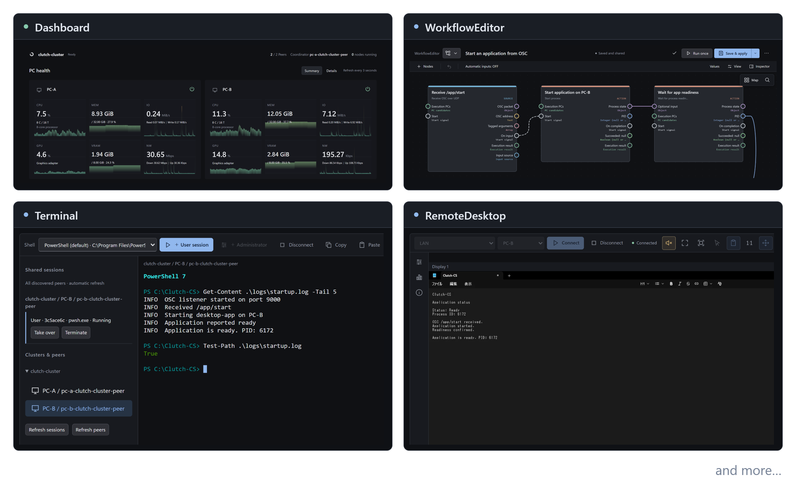

#  Clutch-CS

Clutch-CS は、複数の PC の稼働状況を監視し、各 PC の設定変更、アプリケーションの管理、処理の自動化を行うシステムです。
ブラウザーからログの確認やファイル転送、ターミナル・リモートデスクトップによるリモート操作ができます。
通信やデータ変換などをワークフローで組み合わせ、各処理の実行先となる PC を指定できます。

> ※ 画面は開発中のものです。

## 使い始める

> [!WARNING]
> Clutch-CS は、信頼できるローカルLAN環境での利用を前提としています。外部からのアクセスを想定したセキュリティ対策は行っていません。

Windows 版の配布 ZIP を展開し、直下の **Clutch-CS-Setup.exe** を起動してください。
インストールから管理画面への接続までの手順は、次の 3 ページにまとまっています。

1. [Clutch-CS をインストールする](docs/guides/install.md)
2. [管理画面を開き、PC の接続を確認する](docs/guides/web-client.md)
3. [最初のワークフローを作る](docs/guides/workflows.md)

Windows を必須対応環境としています。Linux・macOS は Best-Effort で、OS に依存する機能には制限があります。

## 推奨動作環境

| 項目 | 推奨構成 |
| --- | --- |
| OS | Windows 11 Pro バージョン 25H2 以降 |
| CPU | 第8世代以降の Intel® Core™ プロセッサー または AMD Ryzen™ プロセッサー（Zen 2 アーキテクチャ以降） |
| メモリ | 16 GB 以上 |
| ストレージ | TLC NAND フラッシュメモリを採用した SSD |

SSD の空き容量は、**20 GB とドライブ容量の 3 分の 1 のうち、大きい方以上**を推奨します。

## 機能と対応環境

表の OS・CPU は、CoreService／ClientHost を動かす PC の環境を表します。

✅ 対応　🟡 対応（未確認）　🚧 整備中・整備予定　❌ 非対応 
🔶 部分対応　🔸 部分対応（未確認）

🟡 と 🔸 は、対象環境での動作確認が未完了であることを示します。

| Clutch-CS 実装機能 | Win-x64 | Win-arm64 | Linux-x64 | Linux-arm64 | Mac-arm64 |
| --- | :---: | :---: | :---: | :---: | :---: |
| 対話型インストーラー（導入・更新・修復・削除） | ✅ | 🚧 | 🟡 | 🟡 | 🟡 |
| Web 管理画面・CLI | ✅ | 🟡 | 🟡 | 🟡 | 🟡 |
| 基本機能 | ✅ | 🟡 | 🟡 | 🟡 | 🟡 |
| [Dashboard](docs/guides/cluster-management.md) | ✅ | 🟡 | 🟡 | 🟡 | 🟡 |
| [WorkflowEditor](docs/reference/workflow-editor.md) | ✅ | 🟡 | 🟡 | 🟡 | 🟡 |
| [HostManager](docs/reference/pc-management.md) | ✅ | 🟡 | 🔸 | 🔸 | 🔸 |
| [FileTransfer](docs/guides/file-transfer.md) | ✅ | 🟡 | 🟡 | 🟡 | 🟡 |
| [Terminal](docs/guides/terminal.md) | ✅ | 🟡 | 🟡 | 🟡 | 🟡 |
| [RemoteDesktop](docs/reference/remote-desktop.md) | ✅ | 🚧 | 🚧 | 🚧 | ❌ |
| [SignalScope](docs/reference/network-capture.md) | ✅ | 🟡 | 🟡 | 🟡 | 🟡 |
| [LogViewer](docs/guides/logs.md) | ✅ | 🟡 | 🟡 | 🟡 | 🟡 |

基本機能には、クラスターの構成・設定共有、共同編集、スナップショットが含まれます。

- RemoteDesktop の対応状況は接続先の PC が対象です。Win-arm64 と Linux（Wayland）への対応を予定しています。
- HostManager の Linux・macOS 対応は、hosts ファイルの編集と Wake-on-LAN に限ります。
- Win-arm64 用の配布物生成・インストールには、追加の整備が必要です。
- RemoteDesktop やメディア変換など一部の機能には、FFmpeg の導入が必要です。実行先の PC に `ffmpeg` と `ffprobe` を用意し、それらを配置したフォルダーを CoreService が参照する環境変数 `PATH` に追加してください。設定ファイルに[実行ファイルのパスを直接指定する](docs/reference/nodes/ai-media.md#登録と実行ファイル)こともできます。

## 目的から探す

| やりたいこと | 読むページ |
| --- | --- |
| 使い方や設定の場所を調べる | [ドキュメント一覧](docs/README.md) |
| 基本用語を調べる | [用語](#用語) |
| PC やアプリケーションの状態を確認する | [クラスターの管理](docs/guides/cluster-management.md) |
| 更新・修復・削除する | [保守の手順](docs/guides/maintenance.md) |
| 問題の原因を調べる | [トラブルシューティング](docs/guides/troubleshooting.md) |
| 設定例を試す | [サンプル一覧](samples/README.md) |
| ソースからビルドする | [開発環境とビルド](docs/development/build.md) |
| 実装を変更する | [ソース構成](docs/development/architecture.md)・[機能要件](docs/reference/requirements.md) |

## システムの構成

| コンポーネント | 役割 |
| --- | --- |
| CoreService | 各 PC でワークフローを実行し、同じクラスターの設定・状態を共有します。 |
| ClientHost | Web クライアントを配信し、管理画面と CoreService の通信を中継します。CoreService とは独立して起動します。 |
| Web クライアント | ブラウザーで使う管理画面です。設定の編集、実行結果の確認、PC の管理を行います。 |
| インストーラー（Installer） | インストール・更新・修復・アンインストールを行います。 |
| 更新プログラム（Updater） | 更新ファイルの検証、プログラムの入れ替え、起動確認を行います。 |
| CLI | コマンドラインから設定や状態を操作します。 |

同じグループ（クラスター）に参加する PC は、同じネットワークに属している必要があります。
管理画面を閉じても CoreService は動作を続けます。

ソリューションは **Clutch-CS.slnx** です。プロジェクト名や名前空間には開発用の識別子 `ReArtWord.Contents.BackgroundService` を使用しています。

## 用語

| 用語名（日本語・英語） | 意味 |
| --- | --- |
| クラスター Cluster | 設定や状態を共有するグループです。処理を実行する PC を参加させて使います。 |
| ホスト Host | Clutch-CS が識別する PC です。 |
| ピア Peer | クラスターに参加する一つの CoreService です。同じホストに複数のピアを配置できます。 |
| ワークフロー Workflow | ノードを接続して組み立てる一連の処理です。処理内容と、実行する PC を指定します。 |
| ノード Node | 処理や値を表す部品です。受信、変換、条件分岐、ファイル操作などを組み合わせます。 |
| 入出力端子 Port | ノード間で値や信号を受け渡す接続口です。TCP・UDP のポート番号とは別のものです。 |
| 信号 Signal | 処理の開始や完了を後続へ知らせるものです。処理するデータとは別に、実行のタイミングを指定できます。 |
| 参加状態 Peer status | Ready は同期と参加条件の確認が済んだ状態、Syncing は同期中です。[状態ごとの意味](docs/guides/web-client.md#接続状態を確認する)も参照してください。 |

詳しい定義や開発時に使う用語は、[ドメイン用語集](docs/development/glossary.md)を参照してください。

## ライセンス

Clutch-CS のライセンスと著作権表記は [LICENSE](LICENSE) を参照してください。
第三者ライブラリの表記は、インストーラーの **Third-party licenses** または管理画面の **OSS License** から確認できます。
