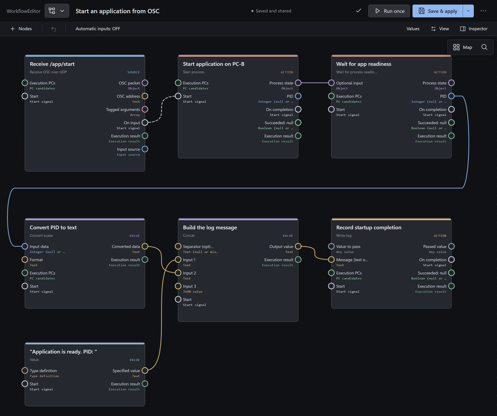

# ワークフローを作る

[ドキュメント一覧](../README.md) · [前へ：管理画面を使う](web-client.md)

ワークフローは、処理や値を表すノードを接続して作成します。
受信・ボタン操作・時刻などをきっかけに、データ変換、ファイル操作、アプリケーションの起動などを実行できます。

## 編集するクラスターを選ぶ

1. 管理画面の **WorkflowEditor** を開いてください。
2. 上段のタブでクラスターを選択してください。
3. 下段のタブで編集するワークフローを選択するか、新しいワークフローを作成してください。

接続できない間も下書きを編集できる場合がありますが、クラスターへの保存・反映には接続が必要です。
接続先や保存先を確認してから作業してください。

## ノードを配置して接続する

1. ノード一覧から必要なノードをキャンバスへドラッグしてください。`Tab` または `Shift+A` からも追加できます。
2. ノードの入力値と設定を入力してください。
3. 出力端子と、次のノードの対応する入力端子を接続してください。
4. 実行先の PC、ネットワーク、ファイルパスを確認してください。

型が異なる端子は、そのままでは接続できません。型を変える場合は変換ノードを使用してください。
「どの PC で実行するか」と「どのネットワークから通信するか」は別の設定です。

次の例では、OSC の `/app/start` を受信し、PC-B の登録済みアプリケーションを起動します。
準備完了を確認してから、プロセスID（PID）を文字列に変換し、メッセージと結合してログに記録します。

使用できるノードは[ノード一覧](../reference/nodes/README.md)、読み込んで試せる定義は[サンプル一覧](../../samples/README.md)から探せます。

## 保存して反映する

1. エラー表示を確認し、入力値や接続の問題を修正してください。
2. **Save & share** で保存・共有してください。
3. 保存結果に加えて、実行に使う版へ反映されたことを確認してください。変更の種類によっては追加の確認が必要です。
4. 想定したきっかけを発生させ、プレビューやログで結果を確認してください。

**保存済みの版と、現在の実行に使われる版は別です。**
共有やスナップショットの作成で問題が起きると、保存できても新しい版への反映が保留される場合があります。
開始済みの処理には、開始時の設定が使用されます。

## サンプルを読み込む

YAML または JSON のワークフローをインポートできます。
サンプルの PC、ネットワーク、パス、接続先を利用環境に合わせて変更してから、検証・保存してください。
外部機器や API を使うサンプルには、個別の準備が必要です。

インポート画面用の YAML / JSON と、CLI の `workflow save --body` に渡す要求 JSON は形式が異なります。
CLI の形式は[管理 CLI](../reference/command-line.md)を参照してください。

## 編集に困ったとき

| 状況 | 確認すること |
| --- | --- |
| ノードが見つからない | `Ctrl+F` で名前・値・入力を検索できます。 |
| エラー箇所へ移動したい | `Ctrl+B` またはワークフローのタブをダブルクリックしてください。 |
| どの PC のファイルか分からない | ノードの実行先とパスの参照先を確認してください。 |
| 他の人の変更と競合した | 比較画面で内容を確認して選択してください。 |
| 保存・実行の結果が分からない | 元の操作 ID・実行 ID で[ログを確認](logs.md)してください。 |
| 保存できない下書きがある | [下書きの復旧](../reference/workflow-editor.md#保存できない下書きの復旧)を参照してください。 |

コピー、共同編集、実行先、プレビュー、信号の扱いなどは[ワークフローの仕様](../reference/workflow-editor.md)で項目別に確認できます。
